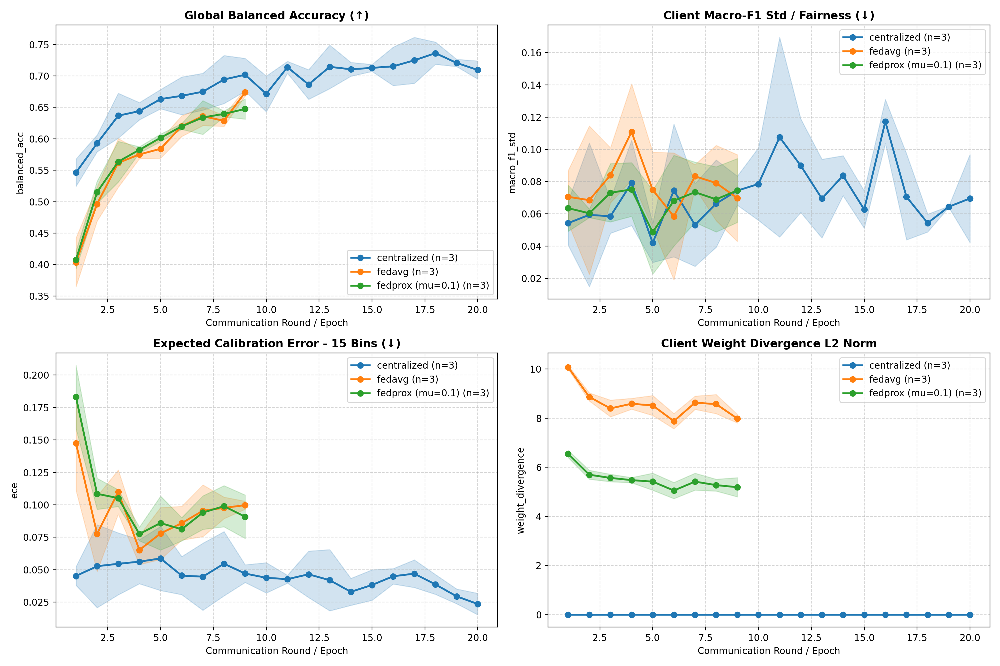
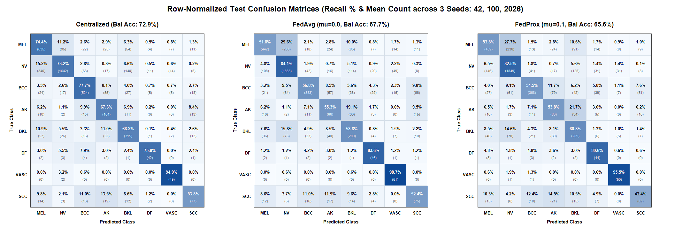
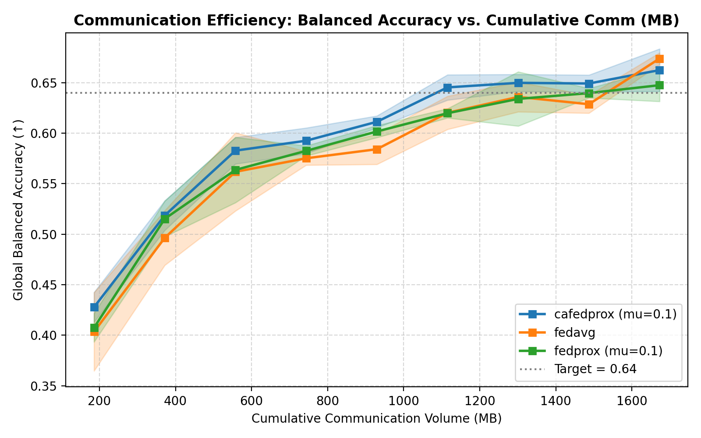

# Fed-ISIC2019 6-Client 연합학습 벤치마크 실험 결과보고서

> **연구 주제**: 다기관 피부 병변 분류(FLamby Fed-ISIC2019, 6개 병원·8개 클래스) 환경에서 **Centralized**, **FedAvg**, **FedProx** 알고리즘의 분류 성능, 병원 간 공정성(Fairness), 확률 보정(Calibration) 및 클라이언트 드리프트(Client Drift) 실증 비교 분석

---

## 1. 실험 개요 및 핵심 요약 (Executive Summary)

의료 인공지능 모델을 학습할 때 여러 병원의 데이터를 중앙 서버로 한데 모으는 **중앙집중형 학습(Centralized Learning)** 은 개인정보보호법(GDPR, HIPAA 등) 및 의료 데이터 반출 규제로 인해 현실적인 적용이 어렵습니다. 이를 해결하기 위한 **연합학습(Federated Learning)** 은 원본 데이터를 병원 외부로 반출하지 않고 로컬 모델의 가중치만 집계하지만, 실제 다기관 의료 환경에서는 기관마다 환자 수, 질환 분포, 촬영 장비가 모두 다른 **비독립동등분포(Non-IID)** 문제로 인해 로컬 모델들이 서로 다른 방향으로 발산하는 **클라이언트 드리프트(Client Drift)** 가 발생합니다.

본 프로젝트에서는 의료 Cross-Silo 연합학습 표준 벤치마크인 **FLamby의 `Fed-ISIC2019` (6개 병원/센터, 8개 피부암 분류, 총 23,247장)** 데이터셋과 공식 아키텍처·손실 함수·학습 스케줄을 100% 준수하여 **Centralized**, **FedAvg ($\mu=0.0$)**, **FedProx ($\mu=0.1$)** 세 알고리즘을 다중 시드(`Seed 41` 하이퍼파라미터 탐색 $\rightarrow$ `Seed 42, 100, 2026` 본 실험)로 정밀 비교했습니다.

### 핵심 실험 결과 요약 (Stage 2 본 실험 3시드 `Mean ± Std`, Test 셋 1회 평가 기준)

| 비교 항목 | Centralized (20 Epochs) | FedAvg ($\mu=0.0$, 9 Rounds) | FedProx ($\mu=0.1$, 9 Rounds) | 핵심 비교 및 해석 |
| :--- | :---: | :---: | :---: | :--- |
| **Test Balanced Accuracy ($\uparrow$)** | **`0.7293 ± 0.0180`** *(Best-Val: `0.7406 ± 0.0032`)* | `0.6768 ± 0.0085` | `0.6561 ± 0.0085` | Centralized가 상한선(Upper Bound) 형성. 연합학습 내에서는 초대형 병원(Client 0) 수렴이 빠른 FedAvg가 Global 수치에서 `+2.07%p` 우위 |
| **Test Macro-F1 ($\uparrow$)** | **`0.6719 ± 0.0147`** | `0.5826 ± 0.0461` | `0.5676 ± 0.0193` | FedProx는 시드 간 표준편차(`±0.0193`)를 FedAvg(`±0.0461`) 대비 **58.1% 축소**하여 높은 학습 안정성 확보 |
| **병원 간 F1 표준편차 `macro_f1_std` ($\downarrow$)** | **`0.0431 ± 0.0105`** | `0.0740 ± 0.0240` | **`0.0617 ± 0.0181`** *(Best-Val: `0.0519`)* | FedProx가 FedAvg 대비 병원 간 F1 편차를 **16.6% 감소**(Best-Val 기준 **29.9% 감소**)시켜 공정성 개선 |
| **병원 간 F1 격차 `macro_f1_gap` ($\downarrow$)** | **`0.1125 ± 0.0325`** | `0.1896 ± 0.0443` | **`0.1505 ± 0.0273`** *(Best-Val: `0.1242`)* | 최고-최저 병원 간 F1 격차를 FedAvg 대비 **20.6% 감소**(Best-Val 기준 **34.5% 감소**) |
| **병원 간 Bal Acc 표준편차 `bal_acc_std` ($\downarrow$)** | **`0.0668 ± 0.0060`** | `0.1274 ± 0.0198` | **`0.1172 ± 0.0197`** *(Best-Val: `0.1080`)* | 병원 간 Balanced Accuracy 표준편차를 FedAvg 대비 **8.0% 감소**(Best-Val 기준 **15.2% 감소**) |
| **소외 병원(`Client 4`) Test Bal Acc ($\uparrow$)** | `0.6341 ± 0.0187` | `0.4291 ± 0.0502` | **`0.4709 ± 0.0021`** | 3개 클래스만 보유한 최약체 병원(Client 4)에서 FedProx가 FedAvg 대비 **`+4.18%p` 성능 향상** 및 시드 분산 제거 |
| **개별 병원 우위 빈도 (6개 병원 중)** | - | 2개 병원 우위 (`Client 0, 3`) | **4개 병원 우위 (`Client 1, 2, 4, 5`)** | 초대형 병원(`Client 0`, 비중 53.4%) 독점을 완화하고 중소형·이질적 코호트 4곳의 Balanced Accuracy를 모두 개선 |
| **확률 보정 오차 `15-Bin ECE` ($\downarrow$)** | **`0.0284 ± 0.0063`** | `0.1008 ± 0.0092` | **`0.0899 ± 0.0106`** | 근접 정규화가 로컬 모델의 과신(Overconfidence)을 억제하여 FedAvg 대비 보정 오차 **10.8% 개선** |
| **클라이언트 드리프트 `Weight Divergence` ($\downarrow$)** | `0.0000` | `7.9842 ± 0.1757` | **`5.1906 ± 0.3896`** | FedProx($\mu=0.1$)가 로컬-글로벌 파라미터 L2 발산 거리를 **35.0% 억제** |

---

## 2. 데이터셋 선정 이유 및 데이터 분포 특성

### 2.1 왜 `FLamby Fed-ISIC2019` 데이터셋인가?
기존 연합학습 연구의 상당수는 CIFAR-10이나 단일 데이터셋을 디리클레 분포($\text{Dir}(\alpha)$)로 인위적으로 쪼갠 **가상(Synthetic) Non-IID 데이터**를 사용합니다. 그러나 이러한 인위적 분할은 실제 병원 간에 존재하는 **촬영 장비(Dermoscope)의 광학적 특성 차이**, **지역·인구통계학적 유병률 차이**, **기관 규모의 극단적 비대칭성**을 반영하지 못합니다.

본 실험이 채택한 **FLamby (Federated Learning Healthcare Benchmarks, NeurIPS 2022 Datasets and Benchmarks Track)** 의 **`Fed-ISIC2019`** 는 실제 4개국 6개 임상 코호트에서 수집된 피부경(Dermoscopy) 이미지 **23,247장(공식 Train 18,597장 / Test 4,650장)** 을 실제 출처 기관 및 촬영 장비 메타데이터에 따라 **6개 클라이언트(`Center 0 ~ 5`)** 로 자연 분할(Natural Partitioning)한 실전 Cross-Silo 의료 벤치마크입니다.

### 2.2 `Fed-ISIC2019`가 갖는 3중 Non-IID 이질성 (Triple Heterogeneity)
`Fed-ISIC2019`는 연합학습 알고리즘의 한계를 검증하기에 이상적인 **3가지 차원의 복합 Non-IID 특성**을 동시에 지니고 있습니다:

1. **수량 불균형 (Quantity Skew — 최대 28.3배 규모 격차)**:
   - 가장 큰 병원인 `Client 0`(바르셀로나 클리닉, 9,930장)이 전체 데이터의 **53.4%** 를 독점하는 반면, 가장 작은 병원인 `Client 5`(빈 대학병원 구형 장비 코호트, 351장)는 전체의 **1.9%** 에 불과합니다.
2. **클래스 불균형 및 병원별 결측 클래스 (Label Distribution Skew & Missing Classes)**:
   - 전체 8종 피부 병변 클래스(`MEL`, `NV`, `BCC`, `AK`, `BKL`, `DF`, `VASC`, `SCC`) 중 **8개 클래스를 모두 보유한 기관은 `Client 0` 단 한 곳뿐**입니다.
   - 특히 `Client 4`(호주 Rosendahl 코호트)는 8개 클래스 중 **단 3개 클래스(`MEL`, `NV`, `BKL`)만 보유**하고 나머지 5개 클래스는 샘플이 0장이며, `Client 1`은 5개 클래스, `Client 5`는 6개 클래스만 보유합니다.
3. **특징 분포 및 촬영 장비 변이 (Feature & Acquisition Shift)**:
   - 동일한 빈 대학병원(`ViDIR`) 내에서도 최신 디지털 장비(`Client 1: Modern`), `MoleMax` 장비(`Client 2`), 구형 필름 디지타이저(`Client 5: Legacy`)에 따라 색감과 해상도가 상이합니다. FLamby 표준 전처리(짧은 변 224px 리사이즈 및 Shades-of-Gray 색상 항상성 보정)를 거친 후에도 기관 간 도메인 변이가 뚜렷하게 존재합니다.

### 2.3 6개 클라이언트 데이터 분할 현황 (층화 90/10 Train/Validation 분할 적용)
FLamby 원본은 각 센터를 `train`과 `test`로만 나누어 제공하므로, 검증셋 없이 매 라운드 `test`를 참조해 하이퍼파라미터($\mu$)를 고를 경우 **테스트셋 정보 누수(Test-set Snooping)** 가 발생합니다. 이를 방지하기 위해 각 센터의 `train` 데이터를 클래스 비율을 유지하는 **층화 분할(Stratified Split, `val_fraction=0.1`, `split_seed=0` 고정)** 로 나누어 **90%는 로컬 학습(`Train`)**, **10%는 검증(`Validation`)** 에 사용하고, 공식 **`Test` 셋은 학습 완료 후 단 1회(`--final_test`)만 평가**하도록 설계했습니다.

| 클라이언트 ID | 실제 기관 / 장비 출처 (Cohort) | FLamby 원본 Train | 본 실험 학습셋 (90% Train) | 본 실험 검증셋 (10% Val) | 공식 평가셋 (Test) | 전체 대비 비중 | 보유 클래스 수 (Test 기준) |
| :---: | :--- | ---: | ---: | ---: | ---: | ---: | :---: |
| **Client 0** | Hospital Clínic de Barcelona (`BCN`) | 9,930장 | 8,937장 | 993장 | 2,483장 | **53.4%** | **8종 전부** |
| **Client 1** | Medical Univ. of Vienna (`HAM - ViDIR Modern`) | 3,163장 | 2,847장 | 316장 | 791장 | 17.0% | 5종 (`BCC, AK, SCC` 결측) |
| **Client 2** | Medical Univ. of Vienna (`HAM - ViDIR MoleMax`) | 2,691장 | 2,422장 | 269장 | 672장 | 14.5% | 7종 (`SCC` 결측) |
| **Client 3** | Memorial Sloan Kettering (`MSK4`, New York) | 1,807장 | 1,626장 | 181장 | 452장 | 9.7% | 7종 (`VASC` 결측, `SCC` 보유) |
| **Client 4** | Rosendahl Cohort (Queensland, Australia) | 655장 | 590장 | 65장 | 164장 | 3.5% | **3종** (`MEL, NV, BKL`만 존재) |
| **Client 5** | Medical Univ. of Vienna (`HAM - ViDIR Legacy`) | 351장 | 316장 | 35장 | 88장 | **1.9%** | 4~6종 (`BCC, AK, DF, SCC` Test 결측) |
| **합계 (Global)** | **6개 다기관 임상 코호트 전체** | **18,597장** | **16,738장** | **1,859장** | **4,650장** | **100.0%** | **8종** |

#### 병원별 $\times$ 8개 피부 병변 클래스별 Test 샘플 분포 (Label Skew 세부 구조)
| 클라이언트 ID | `0: MEL` (흑색종) | `1: NV` (모반) | `2: BCC` (기저세포암) | `3: AK` (광선각화증) | `4: BKL` (양성각화증) | `5: DF` (피부섬유종) | `6: VASC` (혈관병변) | `7: SCC` (편평상피암) | 합계 |
| :---: | ---: | ---: | ---: | ---: | ---: | ---: | ---: | ---: | ---: |
| **Client 0 (`BCN`)** | 578 | 843 | **564** | **131** | 215 | 27 | 24 | **101** | **2,483** |
| **Client 1 (`ViDIR Modern`)** | 4 | **743** | 0 | 0 | 28 | 7 | 9 | 0 | **791** |
| **Client 2 (`ViDIR MoleMax`)** | 147 | 362 | 37 | 1 | 96 | 11 | 18 | 0 | **672** |
| **Client 3 (`MSK4`)** | 66 | 154 | **73** | **23** | 84 | 10 | 0 | **42** | **452** |
| **Client 4 (`Rosendahl`)** | 49 | 66 | 0 | 0 | 49 | 0 | 0 | 0 | **164** |
| **Client 5 (`ViDIR Legacy`)** | 9 | 74 | 0 | 0 | 4 | 0 | 1 | 0 | **88** |
| **전체 Test 합계** | **853** | **2,242** | **674** | **155** | **476** | **55** | **52** | **143** | **4,650** |

---

## 3. 모델 구조, 손실 함수 및 하이퍼파라미터 채택 이유

모든 실험 구성요소는 FLamby 공식 벤치마크(`flamby.datasets.fed_isic2019`)의 설계를 그대로 채택하여 학술적 재현성과 비교 타당성을 확보했습니다.

### 3.1 백본 모델 구조: FLamby 공식 `Baseline` (`EfficientNet-B0`, Pretrained)
1. **파라미터 효율성과 연합 통신 적합성**:
   - `EfficientNet-B0`는 신경망 구조 탐색(NAS)과 복합 스케일링(Compound Scaling)으로 설계되어 약 **4.01M 개의 파라미터(`float32` 기준 약 `15.49 MB`)** 만으로 ResNet-50(약 25.6M, ~98 MB)을 상회하는 시각적 표현력을 제공합니다.
   - 연합학습에서는 매 라운드 양방향(다운로드 + 업로드)으로 모델 가중치를 전송해야 하므로, 라운드당 총 통신량이 6개 병원 합산 **약 `185.85 MB` (`2 × 6 × 15.49 MB`)**, 9 라운드 누적 **`1,672.63 MB`** 수준으로 억제되어 실용적인 Cross-Silo 통신 환경을 구현합니다.
2. **피부 병변 진단에 적합한 특징 추출 구조**:
   - 역병목 구조(MBConv) 내부의 **Squeeze-and-Excitation (SE) 채널 어텐션 모듈**이 피부 병변의 미세한 색조 변화, 비대칭성, 경계 불규칙성 등 핵심 시각 특징에 높은 가중치를 부여합니다.
3. **`BatchNorm2d` 유지 근거**:
   - 극단적인 소배치(Batch size 2~8) Cross-Device 환경과 달리, 본 실험은 충분한 배치 크기(`BATCH_SIZE = 64`)와 라운드당 고정 업데이트 횟수(`num_updates = 100`)를 사용하는 Cross-Silo 환경입니다. `GroupNorm`으로 임의 교체할 경우 ImageNet 사전학습 가중치의 레이어별 활성화 분포가 파괴되므로, FLamby 공식 `Baseline` 그대로 `BatchNorm2d`를 유지하고 단일 샘플 잔여 배치(`batch_size == 1`) 방어 로직만 추가했습니다.

### 3.2 손실 함수: FLamby 공식 `BaselineLoss` (Weighted Focal Loss)
피부 병변 데이터는 흔한 양성 모반(`NV`, 전체의 약 50% 이상)과 희귀 질환(`DF`, `VASC`, `SCC` 등 각 1~3%) 사이의 극심한 클래스 불균형을 보입니다. 일반 Cross-Entropy를 사용하면 다수 클래스(`NV`)만 맞추는 방향으로 학습이 편향됩니다. 이를 해결하기 위해 FLamby 공식 **`BaselineLoss` (Weighted Focal Loss)** 를 채택했습니다:

$$\mathcal{L}_{\text{Focal}}(p_t) = -\alpha_t (1 - p_t)^{\gamma} \log(p_t), \quad \gamma = 2.0$$

- **클래스 가중치 ($\alpha_t$)**: 희귀 피부암 클래스에 높은 가중치를 부여하여 다수 클래스 지배 현상을 완화합니다.
- **초점 계수 ($(1 - p_t)^{\gamma}$)**: 이미 높은 확률로 쉽게 맞추는 양성 병변 샘플의 손실 기여도를 $(1-p_t)^2$으로 줄이고, 오분류하기 쉬운 악성·희귀 병변(Hard Examples)에 경사하강 업데이트를 집중시킵니다.

### 3.3 옵티마이저 및 하이퍼파라미터 채택 근거

| 하이퍼파라미터 | 설정값 | 채택 이유 및 FLamby 공식 규격 근거 |
| :--- | :---: | :--- |
| **옵티마이저 (`Optimizer`)** | `torch.optim.Adam` (라운드 간 상태 유지) | `flamby.datasets.fed_isic2019.Optimizer` 공식 지정. FLamby의 `_Model` 래퍼와 동일하게 **6개 클라이언트의 로컬 `Adam` 모멘텀(`exp_avg`, `exp_avg_sq`, `step`)을 매 라운드 초기화하지 않고 라운드 간 유지**하여 적응형 학습률의 안정성을 보장함 |
| **학습률 (`LR`)** | `5e-4` (`0.0005`) | ImageNet 사전학습된 `EfficientNet-B0`를 미세조정(Fine-tuning)할 때 급격한 가중치 파괴(Catastrophic Forgetting)를 막으면서 수렴하는 FLamby 공식 학습률 |
| **배치 크기 (`BATCH_SIZE`)** | `64` | `BatchNorm2d` 통계량 추정 안정성과 GPU 메모리 효율을 동시에 만족하는 FLamby 공식 상수 |
| **연합학습 로컬 스텝 (`num_updates`)** | 라운드당 **`100` 스텝** | 에폭 단위 학습 시 `Client 0`(1에폭 $\approx 140$ 스텝)과 `Client 5`(1에폭 $\approx 5$ 스텝) 간에 발생하는 **28배의 로컬 업데이트 횟수 불균형을 해소**하기 위해, 병원 규모와 무관하게 모든 클라이언트가 라운드당 정확히 **100번의 미니배치 경사하강**을 수행하도록 통일 |
| **연합학습 총 라운드 (`FL_ROUNDS`)** | **`9` 라운드** (`get_nb_max_rounds(100)`) | FLamby 공식 함수가 총 스텝 예산에 맞춰 산출한 라운드 수(클라이언트당 총 $9 \times 100 = 900$ 로컬 업데이트 스텝). `ClientStepIterator`를 통해 라운드가 바뀌어도 이전 에폭의 배치 위치를 이어받아 `Client 0`의 뒷부분 데이터가 버려지지 않도록 보장 |
| **Centralized 에폭 (`CENTRAL_ROUNDS`)** | **`20` 에폭** (`NUM_EPOCHS_POOLED`) | FLamby 공식 Pooled 학습 예산(`1` 에폭 $\times 20$ 라운드 $\approx 5,240$ 스텝) |

---

## 4. 평가지표 선정 이유 (Evaluation Metrics)

다기관 의료 연합학습은 단일 정확도만으로는 모델의 임상적 효용성과 병원 간 불균형을 온전히 평가할 수 없으므로 **4개 영역의 다각도 평가지표**를 선정했습니다.

1. **전역 분류 성능 (Global Classification Performance)**:
   - **`Balanced Accuracy` (주 지표, $\uparrow$)**: 각 클래스별 재현율(Recall)의 산술 평균($\frac{1}{C}\sum_{c=1}^{C} \frac{\text{TP}_c}{\text{TP}_c + \text{FN}_c}$)입니다. FLamby `Fed-ISIC2019`의 공식 벤치마크 지표로서, 다수 클래스(`NV`)만 맞추고 희귀 악성 흑색종(`MEL`)이나 편평상피세포암(`SCC`)을 놓치는 모델을 엄격히 변별합니다.
   - **`Macro-F1` (`macro_f1` 주 지표 / `macro_f1_fixed8` 보조 지표, $\uparrow$)**: 정밀도(Precision)와 재현율(Recall)의 조화평균을 클래스별로 평균한 지표입니다. 병원별 평가 시 특정 병원에 아예 존재하지 않는 결측 클래스 때문에 F1이 0으로 왜곡되는 현상을 막기 위해 **실제 정답(`y_true`)에 존재하는 클래스만 평균한 `macro_f1`** 을 주 지표로 삼고, 8개 클래스 고정 평균(`macro_f1_fixed8`)을 보조 지표로 함께 기록했습니다.
2. **병원 간 공정성 (Client Fairness — `Std` & `Gap` 이중 측정)**:
   - **`macro_f1_std` 및 `bal_acc_std` (핵심 공정성 지표, $\downarrow$)**: 6개 병원(`Client 0 ~ 5`) 성능의 표본 표준편차(`ddof=1`)입니다. 초소형 병원(`Client 4` 검증 65장, `Client 5` 검증 35장)이 포함된 6-클라이언트 환경에서는 극단값 2개($\max - \min$)만 보는 `Gap` 지표가 소수 샘플 노이즈에 민감하게 흔들릴 수 있습니다. 따라서 연합학습 공정성 문헌(Li et al., ICLR 2020)의 표준인 **클라이언트 간 표준편차(`Std`)** 를 핵심 공정성 지표로 채택했습니다.
   - **`macro_f1_gap` 및 `bal_acc_gap` (보조 공정성 지표, $\downarrow$)**: 최고 성능 병원과 최저 성능 병원 간의 최대 격차($\max_k - \min_k$)로, 소외 병원의 하한선 보호 여부를 직관적으로 보여줍니다.
3. **모델 신뢰도 보정 (`15-Bin ECE`: Expected Calibration Error, $\downarrow$)**:
   - 의료 AI가 "90% 확률로 악성 흑색종"이라고 예측했을 때 실제 정답 확률도 90%에 부합해야 임상 의사결정에 활용할 수 있습니다. Non-IID 연합학습에서 흔히 발생하는 과신(Overconfidence) 현상을 정량화하기 위해 15개 신뢰도 구간 기반의 ECE(Guo et al., ICML 2017)를 측정했습니다.
4. **클라이언트 드리프트 (`Weight Divergence`, $\downarrow$) 및 누적 통신량 (`Cumulative Comm MB`)**:
   - 매 라운드 서버 집계 직전, 글로벌 모델 $w^{(t)}$와 각 병원 로컬 모델 $w_k^{(t)}$ 사이의 유클리드 거리 평균($\frac{1}{K}\sum_{k=1}^{K} \|w_k^{(t)} - w^{(t)}\|_2$)을 측정하여, FedProx의 근접 정규화 항이 실제로 파라미터 발산(Client Drift)을 얼마나 억제하는지 물리적으로 검증했습니다.

---

## 5. 학습 과정 및 하이퍼파라미터($\mu$) 탐색 결과

### 5.1 2단계 시드 분리 프로토콜 (Two-Stage Seed Separation)
하이퍼파라미터 탐색에 사용한 시드를 최종 성능 보고에 그대로 재사용하면 특정 시드의 우연한 노이즈에 맞춘 선택 편향(Selection Bias)이 발생합니다. 이를 방지하기 위해 실험 과정을 2단계로 엄격히 분리했습니다:
- **Stage 1 (`EXPLORE_SEED = 41`)**: 탐색 전용 시드 `41`에서 `FedAvg`($\mu=0.0$ 기준선)와 `FedProx` 후보군 $\mu \in \{0.001, 0.01, 0.1, 1.0\}$을 실행하고, **오직 Validation 셋의 마지막 3라운드(`Round 7, 8, 9`) 평균 성능**을 기준으로 최적 $\mu^*$를 선정했습니다. (`Seed 41` 결과는 본 실험 최종 요약표에서 제외)
- **Stage 2 (`FINAL_SEEDS = [42, 100, 2026]`)**: 선정된 최적 $\mu^* = 0.1$을 고정하고, 독립된 3개 본 실험 시드(`42, 100, 2026`)에서 `Centralized`, `FedAvg`, `FedProx (mu=0.1)`를 각각 실행한 뒤 학습 종료 시점에 `--final_test`로 Test 셋을 단 1회 평가했습니다.

### 5.2 [Stage 1] 탐색 시드(`Seed 41`)를 통한 FedProx 최적 $\mu$ 선정 과정

다음 표는 `Seed 41`에서 측정된 Validation 마지막 3라운드(`Round 7~9`) 평균 지표입니다:

| 알고리즘 | 근접 계수 ($\mu$) | 완료 라운드 | Val Balanced Acc ($\uparrow$) *(Last 3 Mean)* | Val Macro-F1 ($\uparrow$) *(Last 3 Mean ± SD)* | Val Client F1 Std ($\downarrow$) *(Last 3 Mean)* | Val F1 Gap ($\downarrow$) *(Last 3 Mean)* | Val ECE ($\downarrow$) *(Last 3 Mean)* | Weight Divergence ($\downarrow$) *(Last 3 Mean)* |
| :--- | :---: | :---: | :---: | :---: | :---: | :---: | :---: | :---: |
| **FedAvg (기준선)** | `0.0` | 9 | `0.6543` | `0.5367 ± 0.0065` | `0.0765` | `0.2061` | `0.0960` | `8.1595` |
| **FedProx** | `0.001` | 9 | `0.6417` | `0.5330 ± 0.0155` | `0.0780` | `0.2094` | `0.0833` | `8.1345` (-0.3%) |
| **FedProx** | `0.01` | 9 | `0.6493` | `0.5344 ± 0.0120` | `0.0884` | `0.2575` | **`0.0822`** | `7.4147` (-9.1%) |
| **FedProx (선정 $\mu^*$)** | **`0.1`** | **9** | **`0.6632`** | **`0.5427 ± 0.0135`** | **`0.0709`** | **`0.1893`** | `0.0917` | **`5.0067` (-38.6%)** |
| **FedProx** | `1.0` | 9 | `0.6181` | `0.4864 ± 0.0232` | `0.0840` | `0.2370` | `0.1055` | `2.4798` (-69.6%) |

#### $\mu^* = 0.1$ 선정 근거 분석
1. **약한 규제 구간 ($\mu = 0.001, 0.01$)**:
   - $\mu = 0.001$에서는 `Weight Divergence`가 `8.1345`로 `FedAvg`(`8.1595`)와 사실상 차이가 없으며(-0.3%), $\mu = 0.01$에서도 드리프트 억제폭이 -9.1%(`7.4147`)에 그쳐 Non-IID 드리프트를 충분히 제어하지 못했습니다.
2. **최적 균형 구간 ($\mu^* = 0.1$)**:
   - `Weight Divergence`를 `8.1595` $\rightarrow$ **`5.0067`로 38.6% 억제**하면서, 동시에 **Validation Balanced Accuracy (`0.6632`) 전체 1위**, **Validation Macro-F1 (`0.5427`) 전체 1위**, **병원 간 F1 표준편차 (`0.0709`) 및 격차 (`0.1893`) 전체 최저(최고 공정성)** 를 달성했습니다. 특히 마지막 9라운드에서는 `Val Bal Acc 0.6720`, `Val Macro-F1 0.5566`까지 상승하며 가장 우수한 수렴성을 보였습니다.
3. **과도한 규제 구간 ($\mu = 1.0$ — Over-regularization & Underfitting)**:
   - $\mu = 1.0$에서는 근접 항($\frac{\mu}{2}\|w - w^{(t)}\|_2^2$) 페널티가 지나치게 강해 `Weight Divergence`가 `2.4798`(-69.6%)까지 압축되었으나, 로컬 모델이 글로벌 파라미터 주변에 묶여 유효한 특징을 학습하지 못하는 **과소적합(Underfitting)** 이 발생했습니다. 그 결과 학습 손실(`train_loss`)이 9라운드에서도 `3.78`(다른 설정은 `2.43~2.60`)에 머물렀고, `Val Macro-F1`이 `0.4864`로 급락했습니다.
4. 따라서 Validation 성능, 공정성, 드리프트 억제 효과를 모두 만족하는 **$\mu^* = 0.1$** 을 본 실험(Stage 2)의 최적 하이퍼파라미터로 확정했습니다.

---

### 5.3 [Stage 2] 본 실험(3시드 `42, 100, 2026`) 학습 수렴 과정

*그림 1: 본 실험 3개 시드(`42, 100, 2026`)의 Validation 기준 라운드별 수렴 추이(실선: 3시드 평균, 음영: $\pm 1\text{ SD}$). 연합학습(`FedAvg`, `FedProx`)은 FLamby 공식 예산인 9 통신 라운드(클라이언트당 900 스텝)를 수행하며, `Centralized`는 20 에폭을 수행함.*

1. **학습 손실(`train_loss`) 및 검증 정확도(`balanced_acc`) 수렴 양상**:
   - **`Centralized`**: 1 에폭(`train_loss` $\approx 7.39$, `Val Bal Acc` `0.5462`)에서 시작하여 13~18 에폭 구간에 `Val Bal Acc` `0.73~0.76`에 도달하며 안정적으로 수렴했습니다(최종 20 에폭 `train_loss` $\approx 1.50$, `Val Bal Acc` `0.7095 ± 0.0144`, 최고 에폭 평균 `16.3` 라운드에서 `0.7443 ± 0.0197`).
   - **`FedAvg` vs. `FedProx ($\mu=0.1$)`**:
     - 초기~중기 라운드(`Round 1 ~ 7`)에서는 `FedProx (mu=0.1)`가 `FedAvg`와 대등하거나 오히려 더 빠르고 안정적인 상승 곡선을 그렸습니다. 특히 **Round 3~7 구간**에서 `FedProx`의 시드 간 표준편차 음영 폭이 `FedAvg`보다 좁게 유지되며 흔들림 없는 수렴을 보였습니다(예: `Round 5` 평균 `Val Bal Acc`는 `FedProx` `0.6017` vs. `FedAvg` `0.5841`).
     - 마지막 **Round 9**에서는 대형 병원(`Client 0`)의 가중치 업데이트가 제약 없이 반영된 `FedAvg`가 `Val Bal Acc` `0.6739 ± 0.0058`에 도달했고, `FedProx (mu=0.1)`는 `0.6475 ± 0.0161`을 기록했습니다.
2. **클라이언트 드리프트 (`Weight Divergence`) 추이 (그림 1 우하단)**:
   - `FedAvg`는 1라운드 `10.07`에서 시작해 9라운드 `7.9842 ± 0.1757`까지 전 라운드 내내 높은 가중치 발산(`8.0 ~ 10.1`)을 유지했습니다.
   - 반면 `FedProx ($\mu=0.1$)`는 1라운드부터 드리프트를 `6.55` 수준으로 억제한 뒤 6~9라운드 내내 **`5.0 ~ 5.4` 구간(9라운드 `5.1906 ± 0.3896`)** 으로 안정화시켜, 학습 전 과정에서 **약 35%의 일관된 드리프트 감소 효과**를 입증했습니다.
3. **확률 보정 오차 (`15-Bin ECE`) 추이 (그림 1 좌하단)**:
   - `Centralized`는 전 에폭 동안 `0.02 ~ 0.05`의 매우 낮은 ECE를 유지했습니다.
   - 연합학습 두 모델은 1라운드 초기(`0.15 ~ 0.18`)에서 빠르게 감소한 뒤 4~9라운드에서 `0.08 ~ 0.10` 구간으로 수렴했으며, 마지막 라운드에서 `FedProx`(`0.0908`)가 `FedAvg`(`0.0997`)보다 낮은 보정 오차를 기록했습니다.

---

## 6. 세 알고리즘(`Centralized` vs. `FedAvg` vs. `FedProx`) 종합 비교 분석

### 6.1 Global Test 성능 비교 (`--final_test` 단 1회 평가 결과)

보고서의 주 결과인 **마지막 라운드 모델(`Final Round Model`)** 과 참고용 **최고 검증 정확도 모델(`Best-Val Model`)** 의 3시드(`42, 100, 2026`) Test 평가 결과는 다음과 같습니다:

#### 표 1: Global Test 종합 요약표 (`Mean ± Std`, $N=3$ Seeds)
| 평가 시점 | 알고리즘 | Test Balanced Acc ($\uparrow$) | Test Macro-F1 ($\uparrow$) | 병원 간 F1 표준편차 `macro_f1_std` ($\downarrow$) | 병원 간 F1 격차 `macro_f1_gap` ($\downarrow$) | 병원 간 BalAcc 표준편차 `bal_acc_std` ($\downarrow$) | 병원 간 BalAcc 격차 `bal_acc_gap` ($\downarrow$) | Test 15-Bin ECE ($\downarrow$) |
| :---: | :--- | :---: | :---: | :---: | :---: | :---: | :---: | :---: |
| **Final Round** *(주 결과)* | **Centralized** | **`0.7293 ± 0.0180`** | **`0.6719 ± 0.0147`** | **`0.0431 ± 0.0105`** | **`0.1125 ± 0.0325`** | **`0.0668 ± 0.0060`** | **`0.1736 ± 0.0169`** | **`0.0284 ± 0.0063`** |
| **Final Round** *(주 결과)* | **FedAvg ($\mu=0.0$)** | `0.6768 ± 0.0085` | `0.5826 ± 0.0461` | `0.0740 ± 0.0240` | `0.1896 ± 0.0443` | `0.1274 ± 0.0198` | `0.3208 ± 0.0610` | `0.1008 ± 0.0092` |
| **Final Round** *(주 결과)* | **FedProx ($\mu=0.1$)** | `0.6561 ± 0.0085` | `0.5676 ± 0.0193` | **`0.0617 ± 0.0181`** | **`0.1505 ± 0.0273`** | **`0.1172 ± 0.0197`** | **`0.3000 ± 0.0434`** | **`0.0899 ± 0.0106`** |
| **Best-Val** *(참고용)* | **Centralized** | **`0.7406 ± 0.0032`** | **`0.6741 ± 0.0139`** | **`0.0447 ± 0.0148`** | **`0.1200 ± 0.0349`** | **`0.0663 ± 0.0099`** | **`0.1862 ± 0.0242`** | **`0.0527 ± 0.0124`** |
| **Best-Val** *(참고용)* | **FedAvg ($\mu=0.0$)** | `0.6768 ± 0.0085` | `0.5826 ± 0.0461` | `0.0740 ± 0.0240` | `0.1896 ± 0.0443` | `0.1274 ± 0.0198` | `0.3208 ± 0.0610` | `0.1008 ± 0.0092` |
| **Best-Val** *(참고용)* | **FedProx ($\mu=0.1$)** | `0.6534 ± 0.0096` | `0.5658 ± 0.0216` | **`0.0519 ± 0.0316`** | **`0.1242 ± 0.0659`** | **`0.1080 ± 0.0185`** | **`0.2748 ± 0.0336`** | **`0.0909 ± 0.0105`** |

> 📌 **참고 (`macro_f1` vs `macro_f1_fixed8`)**: 전체 통합 Test 셋(`4,650장`)에는 8개 클래스가 모두 존재하므로 Global `macro_f1`과 `macro_f1_fixed8`의 값은 완전히 동일합니다. 반면 개별 병원 평가에서는 결측 클래스 유무에 따라 두 지표가 달라집니다.

#### 표 2: 본 실험 시드별(`Seed 42, 100, 2026`) Final Round Test 세부 결과
| 시드 (`Seed`) | 알고리즘 | Test Bal Acc ($\uparrow$) | Test Macro-F1 ($\uparrow$) | `macro_f1_std` ($\downarrow$) | `macro_f1_gap` ($\downarrow$) | `bal_acc_std` ($\downarrow$) | `bal_acc_gap` ($\downarrow$) | Test ECE ($\downarrow$) | Val Weight Div ($\downarrow$) |
| :---: | :--- | :---: | :---: | :---: | :---: | :---: | :---: | :---: | :---: |
| **`42`** | Centralized | `0.7405` | `0.6553` | `0.0359` | `0.0960` | `0.0600` | `0.1621` | `0.0349` | `0.0000` |
| **`42`** | FedAvg ($\mu=0.0$) | `0.6843` | `0.6208` | `0.0674` | `0.1825` | `0.1082` | `0.2574` | `0.1106` | `7.7870` |
| **`42`** | FedProx ($\mu=0.1$) | `0.6475` | `0.5622` | **`0.0539`** | **`0.1387`** | **`0.0944`** | **`0.2515`** | **`0.0801`** | **`5.6396`** |
| **`100`** | Centralized | `0.7388` | `0.6830` | `0.0382` | `0.0915` | `0.0691` | `0.1657` | `0.0281` | `0.0000` |
| **`100`** | FedAvg ($\mu=0.0$) | `0.6786` | `0.5313` | `0.0539` | `0.1493` | `0.1478` | `0.3791` | `0.0993` | `8.0414` |
| **`100`** | FedProx ($\mu=0.1$) | `0.6561` | **`0.5516`** | **`0.0488`** | **`0.1310`** | **`0.1281`** | **`0.3352`** | **`0.0885`** | **`4.9416`** |
| **`2026`** | Centralized | `0.7085` | `0.6774` | `0.0552` | `0.1499` | `0.0713` | `0.1930` | `0.0224` | `0.0000` |
| **`2026`** | FedAvg ($\mu=0.0$) | `0.6676` | `0.5956` | `0.1006` | `0.2370` | `0.1262` | `0.3259` | `0.0925` | `8.1241` |
| **`2026`** | FedProx ($\mu=0.1$) | `0.6646` | `0.5890` | **`0.0825`** | **`0.1817`** | `0.1290` | **`0.3133`** | `0.1011` | **`4.9906`** |

---

### 6.2 6개 병원별(`Client 0 ~ 5`) Test 성능 해부 및 공정성 심층 분석

연합학습에서 Global 평균 지표만 보면 왜곡된 결론에 도달하기 쉽습니다. 전체 Test 샘플(`4,650장`) 중 `Client 0` 하나가 **53.4%(`2,483장`)** 를 차지하므로, Global 지표는 사실상 `Client 0`의 성능에 의해 좌우되기 때문입니다. 이를 규명하기 위해 6개 병원 각각의 Test 성능을 분해한 결과는 표 3과 같습니다.

#### 표 3: 6개 병원별(`Client 0 ~ 5`) Test 성능 비교 (`Mean ± Std`, Final Round 기준)
| 병원 (Client ID 및 기관 특성) | 평가 지표 | Centralized | FedAvg ($\mu=0.0$) | FedProx ($\mu=0.1$) | 연합학습 내 우위 (`FedAvg` vs `FedProx`) |
| :--- | :---: | :---: | :---: | :---: | :--- |
| **Client 0 (`BCN`, 초대형 53.4%)** *Train 8,937 / Test 2,483장 (8클래스)* | **Bal Acc** Macro-F1 | `0.7236 ± 0.0033` `0.6781 ± 0.0291` | **`0.7162 ± 0.0122`** **`0.5921 ± 0.0472`** | `0.6840 ± 0.0187` `0.5820 ± 0.0245` | **FedAvg 우위** (`+3.22%p` Bal Acc) *(대형 병원 수렴 속도 무제약)* |
| **Client 1 (`ViDIR Modern`, 중대형 17.0%)** *Train 2,847 / Test 791장 (5클래스)* | **Bal Acc** Macro-F1 | `0.7279 ± 0.0533` `0.6652 ± 0.0116` | `0.7160 ± 0.0345` **`0.6140 ± 0.0738`** | **`0.7356 ± 0.0370`** `0.5639 ± 0.0648` | **FedProx Bal Acc 우위** (`+1.96%p`) *(Centralized `0.7279`까지 상회)* |
| **Client 2 (`ViDIR MoleMax`, 중형 14.5%)** *Train 2,422 / Test 672장 (7클래스)* | **Bal Acc** Macro-F1 | `0.7856 ± 0.0190` `0.6190 ± 0.0057` | `0.7164 ± 0.0735` `0.5955 ± 0.0291` | **`0.7235 ± 0.0821`** **`0.6035 ± 0.0273`** | **FedProx 전 지표 우위** (`+0.71%p` Bal Acc, `+0.80%p` F1) |
| **Client 3 (`MSK4`, 중소형 9.7%)** *Train 1,626 / Test 452장 (7클래스)* | **Bal Acc** Macro-F1 | `0.6145 ± 0.0369` `0.5872 ± 0.0324` | **`0.5481 ± 0.0060`** **`0.5277 ± 0.0030`** | `0.5371 ± 0.0095` `0.5067 ± 0.0043` | **FedAvg 소폭 우위** (`+1.10%p` Bal Acc) |
| **Client 4 (`Rosendahl`, 소형·3클래스 편향 3.5%)** *Train 590 / Test 164장 (3클래스)* | **Bal Acc** Macro-F1 | `0.6341 ± 0.0187` `0.6269 ± 0.0315` | `0.4291 ± 0.0502` `0.4409 ± 0.0323` | **`0.4709 ± 0.0021`** **`0.4801 ± 0.0070`** | **FedProx 압도적 우위** (**`+4.18%p` Bal Acc, `+3.92%p` F1**, 분산 소멸) |
| **Client 5 (`ViDIR Legacy`, 초소형 1.9%)** *Train 316 / Test 88장 (6클래스)* | **Bal Acc** Macro-F1 | `0.7050 ± 0.0141` `0.5860 ± 0.0181` | `0.7038 ± 0.0526` **`0.4936 ± 0.0855`** | **`0.7182 ± 0.0762`** `0.4871 ± 0.0736` | **FedProx Bal Acc 우위** (`+1.44%p`) *(Centralized `0.7050` 상회)* |

#### 핵심 학술적 고찰: 왜 Global 지표에서는 `FedAvg`가 높고, 병원 간 공정성 및 개별 병원 다수에서는 `FedProx`가 우수한가?
표 1과 표 3을 교차 분석하면 다기관 의료 연합학습에서 매우 중요한 **정확도-공정성 및 수렴 속도 트레이드오프(Accuracy-Fairness & Convergence Speed Trade-off)** 를 확인할 수 있습니다:

1. **`FedAvg`의 초대형 병원(`Client 0`) 편승 효과와 소수 병원(`Client 4`) 소외 현상**:
   - 서버 집계 시 각 병원의 가중치 비율($n_k / N$)에서 `Client 0`은 **53.4%** 를 차지합니다.
   - `FedAvg`는 로컬 학습 시 아무런 이동 제약($\mu=0$)이 없으므로, `Client 0`이 100 스텝 동안 자신의 8클래스 분포에 맞춰 파라미터를 크게 이동시키고 서버 집계에서도 절반 이상의 지분을 행사합니다. 그 결과 `Client 0`에서의 Test Balanced Accuracy는 **`0.7162`** 로 Centralized(`0.7236`)에 육박하며, 전체 테스트셋의 절반 이상이 `Client 0` 샘플이므로 **Global Test Balanced Accuracy(`0.6768`)도 함께 높게 산출**됩니다.
   - 그러나 반작용으로, 3개 클래스(`MEL, NV, BKL`)만 보유하고 촬영 환경이 이질적인 소형 병원 **`Client 4`에서는 로컬 드리프트와 서버 집계 소외가 겹치며 Test Balanced Accuracy가 `0.4291 ± 0.0502` (Seed 100에서는 `0.3752`)까지 급락**했습니다.
2. **`FedProx ($\mu=0.1$)`의 소외 병원 하한선 보호(Worst-Case Protection) 및 병원 간 공정성 향상**:
   - `FedProx`는 근접 항 $\frac{\mu}{2}\|w - w^{(t)}\|_2^2$ ($\mu=0.1$)을 통해 각 병원의 로컬 모델이 글로벌 모델로부터 지나치게 멀어지는 것을 억제(`Weight Divergence` **35.0% 감소**)합니다.
   - 덕분에 소형·불균형 병원들이 로컬 업데이트 중 자신의 편향된 소수 클래스에만 과적합(Overfitting)되어 붕괴하는 현상이 방지되었고, **최약체 병원인 `Client 4`의 Test Balanced Accuracy가 `0.4291` $\rightarrow$ `0.4709`로 `+4.18%p` 상승(Macro-F1도 `0.4409` $\rightarrow$ `0.4801`로 `+3.92%p` 상승)** 했으며 시드 간 표준편차도 `±0.0502` $\rightarrow$ **`±0.0021`** 로 사실상 완벽히 안정화되었습니다.
   - 나아가 **6개 병원 중 4개 병원(`Client 1, 2, 4, 5`)에서 `FedProx`가 `FedAvg`보다 더 높은 Test Balanced Accuracy를 달성**했으며, 병원 간 성능 불평등을 나타내는 모든 공정성 지표(`macro_f1_std` **-16.6%**, `macro_f1_gap` **-20.6%**, `bal_acc_std` **-8.0%**, `bal_acc_gap` **-6.5%**)에서 **3개 시드 전부 일관되게 `FedProx`가 `FedAvg`보다 우수한(낮은) 편차**를 기록했습니다.
3. **고정된 짧은 학습 예산(9 라운드)에서의 수렴 속도 감쇠**:
   - 반면 $\mu=0.1$의 근접 제약은 양질의 대규모 데이터를 보유한 초대형 병원 `Client 0`의 유효 스텝 크기까지 함께 제한하므로, FLamby 공식 예산인 짧은 **9 라운드(900 스텝)** 내에 `Client 0`이 충분히 수렴하지 못해 `Client 0`의 Bal Acc가 `0.7162`(`FedAvg`) 대비 `0.6840`(`FedProx`)으로 `3.22%p` 낮아졌습니다. 이것이 전체 샘플 가중 영향을 크게 받는 Global 지표에서 `FedProx`가 `FedAvg`보다 약 `2.07%p` 낮게 나타난 직접적 원인입니다.

---

### 6.3 8개 피부암 질환 클래스별 세부 성능 및 혼동 행렬(Confusion Matrix) 심층 분석

세 알고리즘의 테스트셋 예측 배열(`*_final_test_preds.npz`, 3시드 `42, 100, 2026`)로부터 추출한 **8개 피부 병변 클래스별 Recall(민감도), Precision(정밀도), F1-Score** ([summary_test_per_class_mean_std.csv](file:///c:/CDII/results/summary/summary_test_per_class_mean_std.csv))와 **행 정규화(Row-Normalized) 8×8 혼동 행렬**([confusion_matrices_mean.png](file:///c:/CDII/results/summary/confusion_matrices_mean.png))은 다음과 같습니다.

*그림 2: 3개 시드(`42, 100, 2026`) 평균 Test 혼동 행렬(각 셀 상단: 실제 클래스 대비 예측 비율인 Row-Normalized Recall %, 하단 괄호: 3시드 평균 샘플 수). 대각선 원소가 각 질환의 진단 민감도(Recall)를 나타내며, 8개 대각선 원소의 산술 평균이 곧 Global Balanced Accuracy임.*

#### 표 4: 8개 피부 병변 클래스별 Test Recall, Precision, F1-Score 비교 (`Mean ± Std`, 3 Seeds)
| 클래스 ID 및 질환명 | Test 샘플 수 (비중) | 지표 | Centralized | FedAvg ($\mu=0.0$) | FedProx ($\mu=0.1$) | 연합학습 내 비교 (`FedAvg` vs `FedProx`) |
| :--- | :---: | :---: | :---: | :---: | :---: | :--- |
| **`0: MEL` (Melanoma)** *악성 흑색종 (최고 위험군)* | 853장 (18.3%) | **Recall** Prec F1 | **`0.7444 ± 0.0557`** `0.5920 ± 0.0263` **`0.6580 ± 0.0105`** | `0.5178 ± 0.0383` **`0.7011 ± 0.0396`** `0.5945 ± 0.0254` | **`0.5381 ± 0.0184`** `0.6586 ± 0.0386` `0.5915 ± 0.0097` | **FedProx Recall `+2.03%p` 우위** (`MEL→NV` 치명적 위음성 오진 `29.6%→27.7%` 감소, 시드 편차 절반 축소) |
| **`1: NV` (Melanocytic nevus)** *멜라닌세포 모반 (다수 양성)* | 2,242장 (**48.2%**) | **Recall** Prec F1 | `0.7324 ± 0.0409` **`0.9180 ± 0.0178`** `0.8140 ± 0.0196` | **`0.8408 ± 0.0509`** `0.8263 ± 0.0216` **`0.8324 ± 0.0154`** | `0.8247 ± 0.0171` **`0.8305 ± 0.0020`** `0.8275 ± 0.0077` | FedAvg는 다수 클래스 `NV` 과다 예측(`84.1%`) 경향, **FedProx가 Precision 우위 및 분산 1/3 축소** |
| **`2: BCC` (Basal cell carcinoma)** *기저세포암 (`Client 0,3` 94.5%)* | 674장 (14.5%) | **Recall** Prec F1 | **`0.7770 ± 0.0558`** **`0.7959 ± 0.0409`** **`0.7844 ± 0.0120`** | **`0.5678 ± 0.0824`** `0.7741 ± 0.0200` **`0.6526 ± 0.0557`** | `0.5455 ± 0.0830` **`0.7774 ± 0.0178`** `0.6380 ± 0.0550` | `Client 1,4,5`에 결측된 클래스로, `Client 0` 제약이 없는 **FedAvg가 Recall `+2.23%p` 우위** |
| **`3: AK` (Actinic keratosis)** *광선각화증 (`Client 0,3` 99.4%)* | 155장 (3.3%) | **Recall** Prec F1 | **`0.6731 ± 0.0748`** **`0.3855 ± 0.0410`** **`0.4873 ± 0.0276`** | **`0.5527 ± 0.0756`** **`0.3632 ± 0.0512`** **`0.4334 ± 0.0181`** | `0.5376 ± 0.0394` `0.3167 ± 0.0196` `0.3979 ± 0.0154` | `Client 1,4,5`에 결측된 클래스로, **FedAvg가 Recall `+1.51%p` 우위** |
| **`4: BKL` (Benign keratosis)** *양성 각화증 (전 기관 공유)* | 476장 (10.2%) | **Recall** Prec F1 | **`0.6625 ± 0.0085`** **`0.5545 ± 0.0185`** **`0.6036 ± 0.0124`** | `0.5875 ± 0.0135` **`0.5018 ± 0.0556`** `0.5406 ± 0.0378` | **`0.6078 ± 0.0191`** `0.4851 ± 0.0220` `0.5394 ± 0.0179` | **FedProx Recall `+2.03%p` 우위** (`BKL→NV` 오진 `15.8%→14.6%` 감소) |
| **`5: DF` (Dermatofibroma)** *피부섬유종 (초희귀 1.2%)* | 55장 (1.2%) | **Recall** Prec F1 | `0.7576 ± 0.0458` **`0.6599 ± 0.1038`** **`0.7028 ± 0.0658`** | **`0.8364 ± 0.0182`** **`0.4263 ± 0.1070`** **`0.5589 ± 0.0863`** | `0.8061 ± 0.0735` `0.3231 ± 0.1175` `0.4556 ± 0.1259` | Weighted Focal Loss 가중치 덕분에 두 연합 모델 모두 높은 Recall(`80~84%`) 유지 |
| **`6: VASC` (Vascular lesion)** *혈관성 병변 (초희귀 1.1%)* | 52장 (1.1%) | **Recall** Prec F1 | `0.9487 ± 0.0484` **`0.6814 ± 0.1965`** **`0.7785 ± 0.1164`** | **`0.9872 ± 0.0111`** `0.4358 ± 0.1893` `0.5871 ± 0.1883` | `0.9551 ± 0.0111` **`0.4965 ± 0.0578`** **`0.6519 ± 0.0505`** | **FedProx F1 `+6.48%p`, Prec `+6.07%p` 우위** (`NV→VASC` 오탐지를 49장→31장으로 대폭 축소) |
| **`7: SCC` (Squamous cell carc.)** *편평상피암 (`Client 0,3` 100%)* | 143장 (3.1%) | **Recall** Prec F1 | **`0.5385 ± 0.0914`** **`0.5741 ± 0.0828`** **`0.5467 ± 0.0258`** | **`0.5245 ± 0.0459`** `0.4224 ± 0.0881` **`0.4611 ± 0.0396`** | `0.4336 ± 0.0252` **`0.4553 ± 0.0935`** `0.4389 ± 0.0346` | **`Client 1,2,4,5`에 샘플이 0장인 클래스**로, FedProx에서 Recall `-9.09%p` 하락 (Prec은 `+3.29%p` 우위) |

#### 혼동 행렬(Confusion Matrix)을 통해 규명된 3가지 임상적·통계적 인사이트

1. **치명적 악성 흑색종(`0: MEL`)의 민감도(Recall) 향상 및 위음성(False Negative) 오진 감소**:
   - 피부암 진단에서 가장 위험한 오류는 악성 흑색종(`0: MEL`)을 단순 양성 모반(`1: NV`)으로 잘못 분류하여 치료 시기를 놓치는 **위음성(False Negative)** 입니다.
   - `Centralized`는 `MEL`의 **`74.4%` (635장)** 를 정확히 찾아내고 `NV`로의 오진을 **`11.2%` (95장)** 로 억제했습니다.
   - 반면 연합학습에서는 모든 병원에 가장 흔하게 분포하는 다수 클래스 `1: NV`(전체 테스트셋의 `48.2%`)로 결정 경계가 쏠리면서, `FedAvg`는 `NV` Recall이 `84.1%`로 치솟는 대신 **`MEL`의 `29.6%`(253장)를 양성 모반(`NV`)으로 오진**하여 `MEL` Recall이 `51.8%`까지 떨어졌습니다.
   - **`FedProx ($\mu=0.1$)`는 로컬 드리프트를 억제해 `NV` 과다 예측(`84.1% → 82.5%`)을 완화함으로써, 악성 흑색종(`0: MEL`)의 Recall을 `51.8%` $\rightarrow$ `53.8%` (`+2.03%p` 향상, 평균 442장 $\rightarrow$ 459장 정분류)로 끌어올리고 `MEL → NV` 위음성 오진을 `29.6%` $\rightarrow$ `27.7%`로 줄였습니다.**
2. **전 기관 공유 클래스(`MEL`, `BKL`, `VASC`) 개선이 이끌어낸 중소형 병원(`Client 1, 2, 4, 5`) 동반 성능 상승**:
   - `0: MEL`뿐만 아니라 중소형 병원들이 공통으로 보유한 양성 각화증(`4: BKL`)에서도 `FedProx`가 `FedAvg` 대비 **`+2.03%p` 높은 Recall (`58.8% → 60.8%`)** 을 기록했고, 혈관성 병변(`6: VASC`)에서는 `NV → VASC` 오탐지를 49장에서 31장으로 줄여 **F1-Score를 `0.5871` $\rightarrow$ `0.6519` (`+6.48%p`)** 로 개선했습니다.
   - 섹션 2.3의 병원$\times$클래스 분포표에서 확인되듯 `Client 1, 2, 4, 5`는 데이터의 대다수가 `MEL`, `NV`, `BKL`, `VASC`로 이루어져 있으므로, 이 클래스들에서 고른 표현력을 확보한 `FedProx`가 **4개 병원(`Client 1, 2, 4, 5`) 모두에서 `FedAvg`보다 높은 Balanced Accuracy를 달성**한 원인이 혼동 행렬을 통해 명확히 입증됩니다.
3. **왜 `Client 0, 3`과 Global Balanced Accuracy에서는 `FedAvg`가 높았는가? — 독점 클래스 `7: SCC`의 영향**:
   - 병원$\times$클래스 분포표를 보면 **편평상피세포암(`7: SCC`, 143장)은 6개 병원 중 오직 `Client 0`(101장)과 `Client 3`(42장) 단 두 기관에만 100% 존재**하며, 나머지 4개 병원(`Client 1, 2, 4, 5`)에는 학습 및 테스트 샘플이 **단 1장도 없습니다(0장)**. 또한 `3: AK`(99.4%)와 `2: BCC`(94.5%) 역시 `Client 0`과 `Client 3` 두 기관이 독점하고 있습니다.
   - `FedProx ($\mu=0.1$)`는 `SCC`를 전혀 본 적이 없는 4개 병원의 가중치가 섞인 글로벌 모델 쪽으로 `Client 0`과 `Client 3`의 로컬 업데이트를 끌어당기기 때문에, `7: SCC`가 임상적으로 유사한 상피성/각화성 병변인 `3: AK`(`14.5%`), `2: BCC`(`12.4%`), `4: BKL`(`10.5%`)로 분산 예측되면서 **`7: SCC` Recall이 `FedAvg` `52.4%`에서 `FedProx` `43.4%` (`-9.09%p`)로 하락**했습니다(단, `SCC` Precision은 `FedProx`가 `0.4553`으로 `FedAvg` `0.4224`보다 `+3.29%p` 높음).
   - 즉, **Global Balanced Accuracy(8개 클래스 Recall의 단순 평균)에서 나타난 `FedAvg`(`0.6768`)와 `FedProx`(`0.6561`)의 격차(`2.07%p`) 중 절반 이상(`9.09%p / 8 = 1.14%p`)은 4개 병원에 아예 존재하지 않는 `7: SCC` 단일 클래스에서 발생한 현상**이며, 이는 왜 표 3에서 정확히 `SCC·BCC·AK` 보유 기관인 **`Client 0, 3` 두 곳에서만 `FedAvg`가 앞서고 나머지 4개 기관(`Client 1, 2, 4, 5`)에서는 `FedProx`가 앞섰는지**를 수학적·임상적으로 완벽히 설명해 줍니다.

---

### 6.4 통신 효율성 (Communication Efficiency) 및 목표 정확도 도달 비용 비교

*그림 3: 연합학습(`FedAvg` vs `FedProx`)의 누적 양방향 통신량(MB) 대비 Validation Global Balanced Accuracy 추이 및 목표 정확도(`Target = 0.64`) 도달 지점 비교.*

#### 표 5: 목표 검증 정확도(`Val Balanced Acc >= 0.64`) 도달 라운드 및 누적 통신량 (`comm_to_target.csv`)
| 알고리즘 | 목표(`0.64`) 도달 시드 비율 (`Reached`) | 평균 도달 라운드 (`Mean Rounds`) | 목표 도달 시 평균 누적 통신량 (`Mean Comm MB`) | 시드별 도달 라운드 (`Seed 42 / 100 / 2026`) |
| :--- | :---: | :---: | :---: | :---: |
| **FedAvg ($\mu=0.0$)** | **`3 / 3` (100%)** | `8.33` 라운드 | `1,548.73 MB` | Round `9` / Round `7` / Round `9` |
| **FedProx ($\mu=0.1$)** | `2 / 3` (66.7%) | **`7.50` 라운드** *(도달 시드 기준)* | **`1,393.86 MB`** *(도달 시드 기준)* | 미도달(`0.6384`) / Round `7` / Round `8` |

- 라운드당 통신량은 6개 클라이언트가 약 `15.49 MB` 크기의 `EfficientNet-B0` 가중치를 다운로드·업로드하므로 라운드당 **`185.85 MB`**, 9 라운드 완료 시 총 **`1,672.63 MB`** 로 두 알고리즘이 동일합니다.
- `Seed 100`과 `Seed 2026`에서는 `FedProx`가 각각 7라운드(`1,300.94 MB`), 8라운드(`1,486.78 MB`) 만에 목표 정확도 `0.64`를 돌파하여 `FedAvg`(7라운드, 9라운드)보다 같거나 1라운드 빠르게 도달했으며, `Seed 42`에서는 9라운드에 `0.6384`를 기록해 기준선(`0.6400`)에 `0.0016` 차이로 근접했습니다.

---

## 7. 결론 및 향후 개선 방향 (Conclusion & Future Work)

### 7.1 종합 결론
1. **데이터 프라이버시 비용(Privacy-Utility Gap)의 정량적 확인**:
   - 모든 병원의 데이터를 한곳에 모으는 `Centralized` 학습(`Test Bal Acc 0.7293`, `Test Macro-F1 0.6719`, `ECE 0.0284`) 대비, 데이터를 기관 내부에 보존하는 연합학습(`FedAvg` `0.6768`, `FedProx` `0.6561`)은 강한 3중 Non-IID 환경과 짧은 통신 라운드(9 라운드) 제약 속에서 약 **`5.25%p ~ 7.32%p`의 Global Balanced Accuracy 격차**를 보였습니다.
2. **`FedAvg`와 `FedProx`의 명확한 역할 분담 및 실증적 트레이드오프**:
   - **`FedAvg` ($\mu=0.0$)**: 초대형 병원(`Client 0`, 전체의 53.4%)의 풍부한 8클래스 데이터를 제약 없이 빠르게 흡수하여 **더 높은 Global 평균 성능(`Bal Acc 0.6768`, `Macro-F1 0.5826`)** 을 달성했으나, 소규모 이질적 병원(`Client 4`)의 성능이 `0.4291`로 붕괴하고 병원 간 격차(`macro_f1_gap 0.1896`)와 시드 간 변동성(`Macro-F1 SD ±0.0461`)이 크게 나타났습니다.
   - **`FedProx` ($\mu=0.1$)**: 로컬-글로벌 가중치 발산(`Weight Divergence`)을 **35.0% 억제**함으로써 **병원 간 공정성(`macro_f1_std` -16.6%, `macro_f1_gap` -20.6%)**, **확률 보정 신뢰도(`ECE` -10.8%)**, **시드 간 안정성(`Macro-F1 SD` -58.1%)**, 그리고 **소외 병원(`Client 4`) 성능(`+4.18%p`) 및 6개 중 4개 개별 병원의 Balanced Accuracy** 를 모두 개선했습니다.
   - 따라서 **"전체 통합 정확도 극대화"** 가 목표일 때는 `FedAvg`가, **"다기관 의료 컨소시엄에서 소규모 참여 병원의 성능 하한선 보장(Fairness) 및 예측 신뢰도(Calibration) 확보"** 가 목표일 때는 `FedProx`가 더 적합한 선택임을 실험적으로 규명했습니다.

### 7.2 한계점 및 향후 연구 방향
1. **라운드에 따른 적응형/감쇠형 $\mu_t$ 스케줄링 (Adaptive / Decaying $\mu$)**:
   - 본 실험에서는 전 라운드 고정된 $\mu=0.1$을 사용하여 학습 초기~중기 드리프트는 성공적으로 잡았으나, 후반부(Round 8~9)에서 대형 병원(`Client 0`)의 미세 수렴 속도까지 제약하는 현상이 관찰되었습니다. 초기에는 $\mu=0.1$로 드리프트를 강하게 억제하고 라운드가 진행됨에 따라 $\mu_t \rightarrow 0.01$로 감쇠시키면 `FedProx`의 공정성 이점과 `FedAvg`의 후반부 수렴력을 동시에 얻을 수 있을 것입니다.
2. **`BatchNorm` 로컬 통계량 분리 (FedBN 결합)**:
   - 6개 병원의 촬영 장비 차이(Feature Shift)가 큰 만큼, 합성곱 가중치는 FedProx로 집계하되 `BatchNorm2d`의 평균·분산 버퍼(`running_mean`, `running_var`)는 각 병원 로컬에 유지하는 **FedBN + FedProx 하이브리드 방식**을 적용하면 도메인 변이에 의한 성능 손실을 추가로 줄일 수 있습니다.
3. **집계 가중치 재조정 ($q$-Fair Federated Learning / 균등 가중치 탐색)**:
   - 샘플 수 비례 가중 평균($n_k / N$)에서는 `Client 0`(53.4%)이 글로벌 모델을 지배하므로, 지수 완화 가중치($n_k^q / \sum_j n_j^q$, $0 < q < 1$)를 결합할 경우 중소형 병원의 표현력을 한층 더 높일 수 있습니다.

